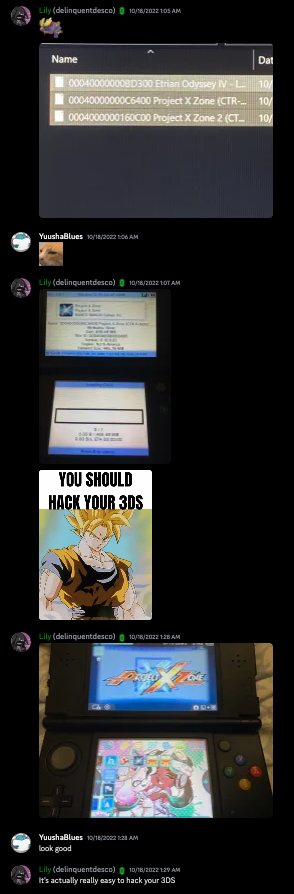
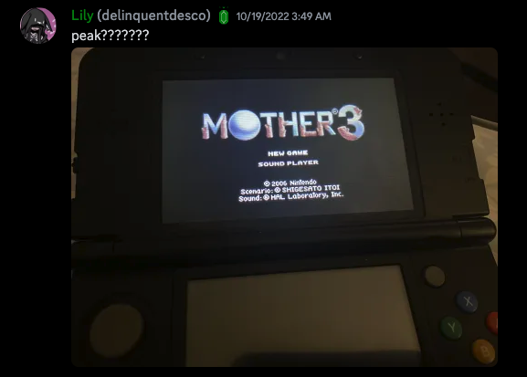
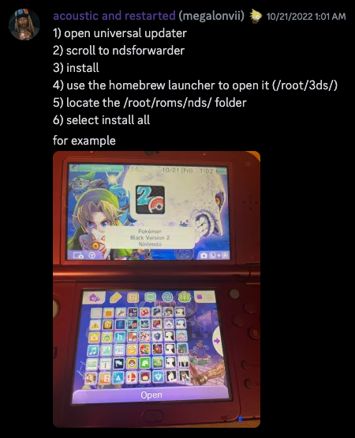
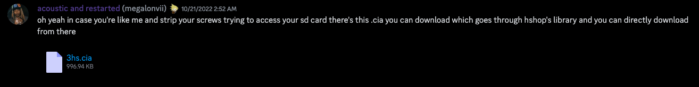
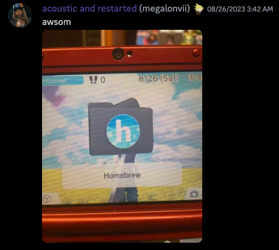
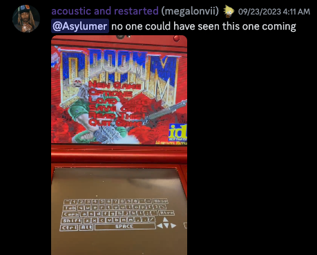
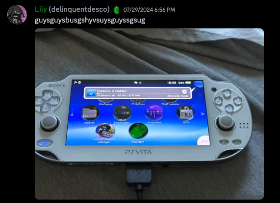
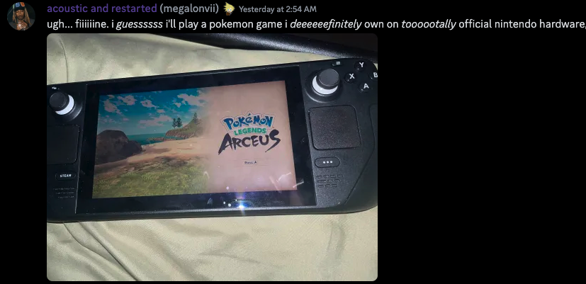

# RIP Bozotendo

***Welcome!*** This is the "Base" for all information I know of about modded consoles I own. I am leaving this repository for everyone in our Discord server to look to in case I am not readily available to assist. Ping me if necessary, however, but more likely than not whatever questions you may have can be answered here.

For site navigation, use the links in the sidebar on the left. If you have something specific you'd like to search, you may use the search at the top right.

<h2 id="fly-shit-only">Fly Shit Only™</h2>

!!! info "Disclaimer"

    This section is mainly meant for showcasing some of the cool things we've done with modded consoles. If you largely only care about modding information, you may skip past this section. **If you have something you want me to highlight, let me know.**

!!! note "The Start"

!!! note "First Person To Mod Their 3DS"

!!! note "First Instance Of Criminality"

!!! note ""Holy Womebrew""

!!! note "First Actual Use Of Homebrew"

!!! note ""Yum" "Holy Womebrew Part 2""

!!! note ""Peak???????""

!!! note "Virginity Themed Power Trip"

!!! note "I Finally Figured Out How To Put DS Games On My Home Menu"

!!! note "Finally Figuring Out What The hShop Is"

!!! note "Birth Of A Legend"

!!! note "Second Actual Use Of Homebrew"

!!! note "Orchestrina"

!!! note ""You Have Uno It Came Free With Your Fucking Modded 3DS""

!!! note "Losing My Mind"

!!! note "A Showcase"

[This is a YouTube Video](https://youtube.com/shorts/mN-vFt8jGPg?feature=share)

!!! note "Captain Falcon And Ness"

!!! note "Becoming A Streamer"

!!! note "Of Course It Can"

!!! note "Crossdimensional Link Protocol (CLP-01)"

")

!!! note "Colonoscopy"

!!! note "Rip Bozony"

!!! note "Dual Booting Vita"

!!! note ""There's Layers To This Shit""

!!! note "Will Sony Ever Do The Right Thing?"

!!! note "The Wiizza"

!!! note "Don't Try This At Home"

